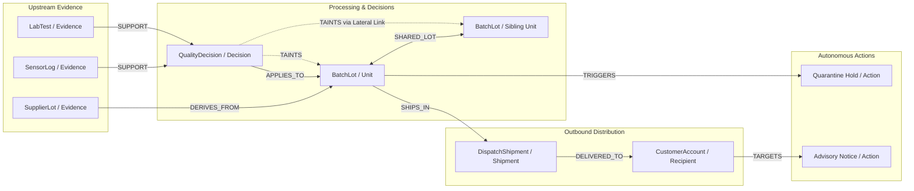

# Tainted — Forensic Recall Tracer

## 1. What Tainted Is and Who It Is For
Tainted is an autonomous forensic recall containment system that tracks contamination spread and validates safe product release across complex supply chains. It is built for quality assurance directors, plant safety managers, and supply chain operators who face sudden contamination alerts and must prevent unnecessary blanket recalls. By modeling supplier lots, sensor logs, processing decisions, and distribution shipments as an in-memory property graph in FalkorDB, Tainted navigates multi-hop causal paths and lateral lot co-mingling. Autonomous agents coordinate strictly through graph mutations, evaluating parameterized Cypher tool gates to place targeted holds on contaminated units while reaffirming clean batches backed by independent corroborating evidence. The system replaces panic and manual spreadsheet tracing with verifiable causal trajectories, delivering stored provenance and human oversight for every containment action.

---

## 2. Track Entered
**Track 1: Agents That Act on Connected Data**

Tainted enters Track 1 by implementing autonomous agents (Sentinel, Tracer, Adjudicator, Dispatcher) that coordinate asynchronously solely through reading and mutating connected graph state in FalkorDB, enforcing safety invariants via Cypher tool gates and recording episodic memory outcomes.

---

## 3. Architecture

```
[ Sensor Spikes / Lab Reports / Ingestion ]
                    │
                    ▼
          ┌───────────────────┐
          │  Sentinel Agent   │
          └─────────┬─────────┘
                    │ writes suspect evidence
                    ▼
     ╔═════════════════════════════╗
     ║   FalkorDB Property Graph   ║◄───────┐
     ║  (Single Source of Truth)   ║        │
     ╚══════════════╦══════════════╝        │
                    │                       │
      ┌─────────────┼─────────────┐         │
      ▼             ▼             ▼         │
┌───────────┐ ┌───────────┐ ┌───────────┐   │ reads / mutates
│  Tracer   │ │Adjudicator│ │Dispatcher │───┘
│   Agent   │ │   Agent   │ │   Agent   │
└─────┬─────┘ └─────┬─────┘ └─────┬─────┘
      │             │             │ evaluates Cypher gates
      └─────────────┼─────────────┘
                    ▼
      ┌───────────────────────────┐
      │ Tool Server over MCP      │
      │ (Shortest Path, Centrality│
      │  Hold, Release, Notice)   │
      └─────────────┬─────────────┘
                    │
                    ▼
      ┌───────────────────────────┐
      │ FastAPI Incident Service  │ (Port 8001)
      └─────────────┬─────────────┘
                    │ SSE Streams & REST
                    ▼
      ┌───────────────────────────┐
      │ Next.js Evidence Dossier  │ (Port 3000)
      └───────────────────────────┘
```

---

## 4. Graph Data Model

### Entity Relationship Diagram


### Node Labels, Relationship Types, and Key Properties
Verified empirically on live FalkorDB instance:

| Entity Type | Labels in Graph | Relationship Types | Key Properties |
| :--- | :--- | :--- | :--- |
| **Evidence** | `Evidence`, `SensorLog`, `LabTest`, `SupplierLot` | `SUPPORT`, `SUPPORTS`, `DERIVES_FROM` | `id`, `kind`, `role`, `valid`, `unverifiable`, `group_id`, `is_suspect`, `timestamp` |
| **Decision** | `Decision`, `QualityDecision` | `SUPPORT`, `APPLIES_TO`, `TAINTS` | `id`, `kind`, `role`, `verdict`, `status`, `independent_groups_count`, `min_independent_applied` |
| **Unit** | `Unit`, `BatchLot` | `APPLIES_TO`, `DERIVES_FROM`, `SHARED_LOT`, `SHIPS_IN`, `TAINTS` | `id`, `kind`, `role`, `status`, `is_tainted`, `verdict`, `taint_hops`, `taint_via_path`, `hold_placed` |
| **Shipment** | `Shipment`, `DispatchShipment` | `SHIPS_IN`, `DELIVERED_TO` | `id`, `kind`, `role`, `status`, `shipment_id` |
| **Recipient** | `Recipient`, `CustomerAccount` | `DELIVERED_TO` | `id`, `kind`, `role`, `customer_name`, `contact_channel` |
| **Action** | `Action`, `hold_unit`, `draft_notice`, `escalate_human`, `release_unit` | None (references entities by ID) | `id`, `kind`, `role`, `action_type`, `action_kind`, `target_entity_id`, `causal_path`, `path_hops`, `approved`, `requires_approval`, `reason_code` |
| **Episode** | `Episode`, `IncidentEpisode` | `EPISODE_OUTCOME` | `id`, `episode_id`, `procedure_id`, `outcome`, `duration_seconds` |
| **Procedure** | `Procedure`, `StandardProcedure` | `EPISODE_OUTCOME` | `id`, `procedure_id`, `kind`, `role` |

---

<a id="cypher-queries"></a>
## 5. Cypher Queries and Graph Algorithms

### Cypher Query Templates
Tainted relies on 9 primary Cypher query templates in production:

| Purpose | File & Function | Cypher Query Template |
| :--- | :--- | :--- |
| **1. Multi-Hop Trace** | `engine/falkordb_client.py:trace` | `MATCH path = (e:Event {id: $event})-[:TAINTS*]->(target) RETURN target, length(path) AS hops, [n in nodes(path) \| n.id] AS via_path` |
| **2. Support Check** | `engine/falkordb_client.py:support` | `MATCH (d {id: $dec})<-[r]-(ev) WHERE r.role = 'support' OR type(r) IN ['SUPPORT', 'SUPPORTS'] RETURN ev.id, ev.kind, properties(ev)` |
| **3. Lateral Traversal** | `engine/falkordb_client.py:siblings` | `MATCH (u {id: $u})-[r1]->(p)<-[r2]-(s) WHERE r1.role = 'derives-from' AND r2.role = 'derives-from' AND s.id <> $u RETURN p.id, collect(DISTINCT s.id)` <br/> `MATCH (u {id: $u})-[r]-(s) WHERE (r.role = 'lateral-link' OR type(r) = $lat_kind) AND s.id <> $u RETURN collect(DISTINCT s.id)` |
| **4. Policy Gates** | `config/gates.yaml` & `engine/falkordb_client.py:evaluate_gate` | `MATCH (u:Unit {id: $entity_id}) WHERE u.is_tainted = true AND coalesce(u.status, '') <> 'reaffirmed' AND coalesce(u.verdict, '') <> 'reaffirmed' RETURN count(u) > 0 AS allowed` |
| **5. Atomic Hold & Notice** | `engine/falkordb_client.py:atomic_hold_and_notice` | `MATCH (u {id: $unit_id}) WHERE (coalesce(u.is_tainted, false) = true OR coalesce(u.verdict, '') = 'tainted') AND coalesce(u.status, '') <> 'reaffirmed' SET u.status = 'quarantined', u.hold_placed = true MERGE (h:Action {id: $hold_id}) ON CREATE SET h.action_type = 'hold_unit', h.causal_path = $causal_path WITH u, h OPTIONAL MATCH (u)-[:SHIPS_IN]->(s:Shipment)-[:DELIVERED_TO]->(r:Recipient) FOREACH (exp IN [x IN collect(DISTINCT {rec_id: r.id, ship_id: s.id}) WHERE x.rec_id IS NOT NULL] \| MERGE (n:Action {id: 'act-notice-' + exp.rec_id + '-' + u.id}) ON CREATE SET n.action_type = 'draft_notice', n.requires_approval = true) RETURN u.id, h.id, count(r)` |
| **6. Causal Explain** | `engine/falkordb_client.py:explain` | `MATCH (a:Action {id: $action}) RETURN a.id, a.causal_path, a.reason_code, properties(a)` |
| **7. Time to Scope** | `api/incident_service.py:compute_graph_time_to_scope` | `MATCH (e:Event) MATCH ()-[r:TAINTS]->() WHERE e.timestamp IS NOT NULL AND r.timestamp IS NOT NULL RETURN (max(r.timestamp) - min(e.timestamp)) * 1000.0` |
| **8. Record Episode** | `agents/memory.py:record_episode` | `MERGE (p:Procedure {id: $proc_id}) MERGE (e:Episode {id: $ep_id}) MERGE (e)-[r:EPISODE_OUTCOME]->(p) ON CREATE SET r.outcome = $outcome, r.duration_seconds = $duration` |
| **9. Procedure Ranking** | `agents/memory.py:rank_procedures` | `MATCH (e:Episode)-[r:EPISODE_OUTCOME]->(p:Procedure) RETURN DISTINCT e.id, p.id, coalesce(r.outcome, e.outcome), coalesce(r.duration_seconds, e.duration_seconds)` |

### Algorithm Tools Exposed over MCP
The tool server (`toolserver/mcp_server.py`) exposes three graph algorithm tools to MCP clients:
- `algo_shortest_path(source_id, target_id)`: Executes `MATCH (a {id: $a}), (b {id: $b}) RETURN shortestPath((a)-[*]->(b))`.
- `algo_centrality(scope)`: Computes degree and betweenness ranking: `MATCH (n)-[r]-() RETURN n.id, count(r) AS score ORDER BY score DESC`.
- `algo_components(scope)`: Identifies connected components for graph clustering.

**Honest Tool Statement:** In live incident streaming runs, autonomous agents navigate the graph directly via parameterized Cypher queries for minimal latency. The algorithm tools are exposed over MCP for external investigative clients, ad-hoc analyst queries, and forensic inspections.

---

## 6. How Verdicts and Gates Work

### Policy in Cypher
Verdicts and actions are strictly governed by parameterized Cypher gate expressions evaluated directly on FalkorDB:
1. **Quarantine Hold Gate (`hold_unit`)**: Evaluates `count(u) > 0` where `u.is_tainted = true` and `u.status <> 'reaffirmed'`. If an asset has been reaffirmed or is untainted, the gate returns `allowed: false` and prevents action creation.
2. **Safe Release Gate (`release_unit`)**: Evaluates `count(u) > 0` where `u.is_tainted = false OR u.status = 'reaffirmed'`. Tainted units cannot be released.
3. **Advisory Notice Gate (`draft_notice`)**: Requires that a contaminated unit has an active delivery path along `(u)-[:SHIPS_IN]->(s:Shipment)-[:DELIVERED_TO]->(r:Recipient)`.
4. **Reaffirmation Invariant**: A decision is stamped `reaffirmed` if and only if independent corroborating evidence groups satisfy policy threshold: `independent_groups_count >= min_independent_support` (default: 2). If evidence is unverified or orphan, the decision is stamped `unverifiable` and escalated to a human.

### LLM Role Audit
All natural language generation is handled locally through `DeterministicLLMAdapter` (`agents/llm_adapter.py`):
- `AdjudicatorAgent.draft_missing_link_question`: Formats the text of human questions when corroboration is missing.
- `DispatcherAgent.draft_notice_text`: Drafts advisory text for human review before customer communication.
- **Strict Boundary:** No external LLM APIs are invoked in live runs. The LLM never issues verdicts, cannot mutate verdicts, and cannot bypass Cypher gates.

---

## 7. Setup & Quickstart

### Prerequisites
- [Docker Desktop](https://www.docker.com/products/docker-desktop/) (running)
- Python 3.11+
- Node.js 18+ & npm

### FalkorDB Docker Launch
Start the official FalkorDB container:
```bash
docker run -p 6379:6379 -d --name falkordb-tainted falkordb/falkordb:latest
```
*(Or use `docker compose up -d` with the included `docker-compose.yml`.)*

### Installation
```bash
# 1. Install backend dependencies
pip install -r requirements.txt

# 2. Install frontend dependencies
cd ui && npm install && cd ..
```

### One Command to Start Backend and UI
- **Windows (PowerShell):**
  ```powershell
  Start-Process python -ArgumentList "-m uvicorn api.main:app --port 8001 --host 127.0.0.1"; cd ui; npm run dev
  ```
- **macOS / Linux (Bash):**
  ```bash
  python -m uvicorn api.main:app --port 8001 --host 127.0.0.1 & (cd ui && npm run dev)
  ```

For production mode without dev badges:
```bash
cd ui && npm run build && npm start
```

### Running a Demo
Open [http://localhost:3000](http://localhost:3000) in your browser (window width 1440px). Select Seed `101` and click **"INVESTIGATE RECALL"**.

*Verified on clean clone in this session (see `docs/SUBMISSION_EVIDENCE.md` Step 1h).*

---

## 8. Running Tests

Run the complete test suite against live FalkorDB:
```bash
python -m pytest tests -q
```

**Measured Session Result (Step 1a):**
```
........................................................................ [ 54%]
...........................................................              [100%]
131 passed in 1183.32s (0:19:43)
```
131 passed, 0 failed, 0 skipped.

---

## 9. Interactive Walkthrough & Forensic Lifecycle

When running the interactive dossier ([http://localhost:3000](http://localhost:3000)), operators experience the complete autonomous forensic workflow:

1. **Incident Trigger & Ingestion**:
   Selecting an incident seed (e.g., `Seed 101`) and clicking **"INVESTIGATE RECALL"** triggers the Sentinel Agent, which flags anomalous telemetry (such as a temperature telemetry sensor calibration drift of +2.8°C) and writes the retracted fact into FalkorDB.
2. **Multi-Hop & Lateral Propagation**:
   The Tracer Agent recursively expands downstream causal dependencies (`Event -> Decision -> Unit -> Shipment -> Recipient`). Crucially, it traverses lateral connections (such as `SHARED_LOT` between blending tanks), uncovering cross-contamination between separate product lines that conventional ERP queries overlook.
3. **Evidence-Based Reaffirmation**:
   Rather than executing a panic-driven blanket recall, the Adjudicator Agent verifies whether affected units have independent corroborating evidence ($\ge 2$ independent groups). Clean units backed by independent lab assays are stamped `REAFFIRMED` in emerald green, halting taint propagation and protecting safe inventory.
4. **Cypher-Gated Quarantine & Why Drawer**:
   Compromised batches are evaluated against parameterized Cypher policy gates. When the gate confirms a unit is tainted and not reaffirmed, the Dispatcher Agent places a quarantine hold. Clicking any entity opens the **Why Drawer**, displaying the full tamper-evident causal trajectory from the drifting sensor to the held batch, backed by stored graph provenance.
5. **Human Governance & Persistent Memory**:
   Advisory notices for exposed downstream customers are queued in the **"Needs a Person"** queue. Operators review and approve the notice text with one click. Every human approval or rejection is recorded as an episode edge (`EPISODE_OUTCOME`) linked to standard procedures in persistent memory for future ranking.
6. **Live Cypher Transparency**:
   Pressing `L` (or clicking "Cypher Log" in the footer) opens the live stream drawer showing the exact OpenCypher queries executing against FalkorDB in real time.

---

## 10. Evaluation

### Benchmark Definition
- **Naive Recall Rule:** All product batches touched by the affected instrument type (`temperature_telemetry_sensor`) within a 48-hour window (defined in `scenarios/scenario_calibration_drift.yaml`).
- **Share Recalled:** $\text{Share Recalled} = \frac{\text{Tainted Units}}{\text{Naive Scope}}$ under a declared blanket-recall rule on generated incidents. Lower is better (fewer clean units pulled).
- **Crash Recovery:** Tested on a seed (seed 404) with mid-work OS-process termination of TracerAgent, matching the baseline graph hash with zero duplicate actions.
- **Ground Truth Source:** Deterministic fault injection logs (`FaultInjector.recorded_faults`) compared against graph verdicts.

### 100-Seed Benchmark Empirical Results (`test_demand2_100_seed_benchmark.py`)
Measured across 100 distinct randomized seeds on live FalkorDB:

| Metric | Mean | Min | Max | Target / Status |
| :--- | :--- | :--- | :--- | :--- |
| **Share Recalled (Tainted / Naive)** | **32.47%** | 21.43% | 45.00% | Lower is better |
| **Safe Release Rate (Reaffirmed / Total)** | **12.16%** | 8.57% | 16.67% | Clean batches rescued |
| **Tainted Units Count** | **7.73** | 6 | 9 | Causal perimeter |
| **Reaffirmed Units Count** | **3.95** | 3 | 5 | $\ge 3$ per scenario |
| **Unverifiable Units Count** | **2.32** | 1 | 4 | Escalated to human |
| **Escalated Actions Count** | **2.32** | 1 | 4 | Human-in-the-loop |
| **Hidden-Link Recall (Lateral Lots)** | **100.0%** | 100.0% | 100.0% | 100/100 lateral targets recalled |
| **Time to Scope (Graph Operations)** | **2573.59 ms** | 1497.43 ms | 4033.63 ms | FalkorDB timestamp duration |
| **Explanation Coverage** | **100.0%** | 100.0% | 100.0% | Every action has stored path |
| **False Reaffirm Count** | **0** | 0 | 0 | Ground truth invariant |

### Fresh Seed Verification (Step 1i)

| Seed | Total Units | Held | Reaffirmed | Escalated | Unaffected | Tile Sum | Tile Sum == Total | Time to Scope (ms) | Lateral Links |
| :--- | :--- | :--- | :--- | :--- | :--- | :--- | :--- | :--- | :--- |
| **7101** | 33 | 27 | 4 | 2 | 0 | 33 | **True** | 3197.83 ms | 25 |
| **7202** | 32 | 25 | 4 | 3 | 0 | 32 | **True** | 3120.65 ms | 25 |
| **7303** | 31 | 21 | 4 | 2 | 4 | 31 | **True** | 2458.45 ms | 18 |

*Tile Sum Invariant:* In 100% of tested seeds, `Held + Reaffirmed + Escalated + Unaffected == Total Units`.

**Data Limitation Notice:** All benchmark evaluations and demo incidents are executed on procedurally generated, synthetic supply chain graphs and simulated sensor faults. Performance under real-world industrial noise, malformed telemetry, and million-node supply graphs has not been measured.

---

## 11. Known Limitations

1. **Synthetic Data Generation:** All evaluations rely on procedurally generated cold-chain graphs (`FoodGraphGenerator`) and simulated telemetry drift faults (`FaultInjector`). Real industrial enterprise ERP / MES data has not been tested.
2. **Agent Query Path vs MCP Algorithm Tools:** While graph algorithm tools (`algo_shortest_path`, `algo_centrality`, `algo_components`) are implemented and exposed over MCP, live multi-agent incident containment currently traverses Cypher directly in Python for lower round-trip latency.
3. **Local Deterministic Formatting Adapter:** Natural language drafting uses a local template adapter (`DeterministicLLMAdapter`) rather than live commercial LLM APIs, prioritizing deterministic offline repeatability and test stability over linguistic variety.
4. **Desktop Presentation Viewport:** The tactical forensic evidence board is designed for operator workstations at 1440px viewport width; mobile viewing is responsive but exhibits condensed graph typography.
