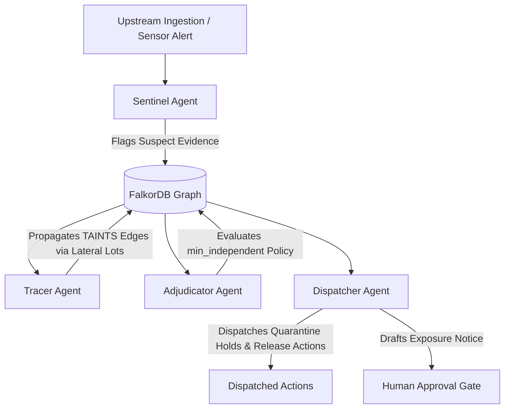

# Tainted — Forensic Recall Tracer

> **Every product recall has a moment of doubt.** A supplier flags a suspect lot, a lab finds an adulterant, or a temperature sensor spikes. The traditional response is a blanket recall: pull every batch, hold every truck, draft frantic customer notifications, and burn millions of dollars in inventory.
> 
> **Tainted** replaces the panic of blanket recalls with the mathematical precision of FalkorDB graph algorithms and Cypher tool gates. By tracing tainted chains-of-custody across supplier lots, blending tanks, finished packs, and cold-chain shipments, Tainted pinpoints the exact contamination perimeter and quietly **reaffirms** clean batches with verifiable independent proof.

---

## 1. Quickstart (One Documented Command)

### Prerequisites
- [Docker Desktop](https://www.docker.com/products/docker-desktop/) (running)
- Python 3.11+
- Node.js 18+ & npm

### Automated Start
To bring up the entire stack (FalkorDB, FastAPI backend, and Next.js UI):

```bash
# 1. Start FalkorDB in Docker
docker compose up -d

# 2. Install Python dependencies and launch API daemon (Port 8001)
pip install -r requirements.txt
python -m uvicorn api.main:app --host 127.0.0.1 --port 8001 &

# 3. Install UI dependencies and start frontend (Port 3000)
cd ui && npm install && npm run dev
```

Open [http://localhost:3000](http://localhost:3000) to view the **Forensic Evidence Dossier**.

---

## 2. Core Architecture & Section 0 Rules

Tainted is designed with zero-trust architectural integrity adhering strictly to **ROADMAP.md Section 0**:

1. **Rule 3 (Zero Hardcoding)**: Kinds, roles, and statuses are declared in ontologies (`packs/`), policies (`config/`), and registry tokens (`api/tokens.json`). No entity or batch IDs are hardcoded in application logic.
2. **Rule 4 (Graph is the Only Shared State)**: Agents do not communicate directly. They coordinate asynchronously by reading and writing nodes and edges to the FalkorDB graph.
3. **Rule 5 (LLM Never Decides; Cypher Gates Rule)**: Tool execution is governed by parameterized Cypher gate expressions evaluated directly in the graph. The LLM never sees a tool the gate has not unlocked.
4. **Rule 7 (Every Action Has a Stored Path)**: Dispatched actions store their full causal trajectory (`causal_path` and `path_hops`), queryable at any time via the **Why Drawer**.

### Agent Loop Topology



---

## 3. The 3-Minute Live Pitch & Reaffirmation Beat

| Timecode | Beat | Narrative & System Action |
| :--- | :--- | :--- |
| **0:00 - 0:30** | **The Crisis & Calm Paper** | Calm, tactile paper canvas loaded with seeded cold-chain topology. Presenter sets the stakes: Pathogen detected in raw spinach lot. |
| **0:30 - 1:15** | **The Multi-Hop Lateral Spread** | Operator triggers incident. Sentinel detects spike; Tracer traverses blending tanks and lateral lot associations, painting affected nodes with vibrant **`HOLD`** stamps. |
| **1:15 - 1:45** | **The Reaffirmation Beat (Core Pitch)** | A downstream lot shares the facility but had independent testing from 2 accredited labs (`min_independent=2`). Adjudicator verifies the independent path, draws back taint, and stamps the node with serene green **`REAFFIRMED`** ink. Blanket recall averted! |
| **1:45 - 2:20** | **The Cypher Tool Gate & MCP** | Presenter opens Tool Gate Verifier. Shows that `hold_unit` cannot be called on a clean batch because the gate query omitted the tool. Shows `algo_shortest_path` over MCP. |
| **2:20 - 3:00** | **Why Drawer & Human Governance** | Presenter clicks an action node. The Why Drawer slides out with the full causal chain-of-custody. Presenter reviews the drafted customer notice and signs off with the **Approve Notice** button. |

---

## 4. Test Suites & Verification

### Run Standard Test Suite
```bash
python -m pytest tests/test_*.py tests/part_c/test_*.py -v
```

### Run Adversarial Audit Suite
```bash
python -m pytest tests/audit/test_adversarial_audit.py -v
```

### Run Linter
```bash
python scripts/lint.py
```

### Run Frontend Static Verification
```bash
cd ui && npm run lint && npm run build
```
