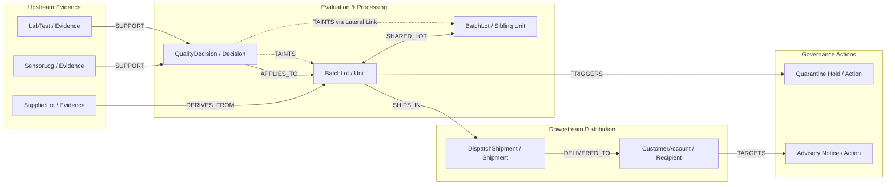

# Tainted — Submission Evidence & Verification Log

Empirical verifications and raw command outputs captured in this session.

---

## Step 1a: Test Suite Verification (`python -m pytest tests -q`)

Full test suite execution across all test packs, audit checks, property tests, and API contracts.

```
........................................................................ [ 54%]
...........................................................              [100%]
131 passed in 1183.32s (0:19:43)
```

**Status:** PASS (131 passed, 0 failed, 0 skipped, 1183.32s runtime).

---

## Step 1b: Algorithm Tools & MCP Tool Server

### Tools exposed over Model Context Protocol (MCP)
The scoped MCP server (`toolserver/mcp_server.py:build_scoped_mcp_server`) exposes tools declared in `config/gates.yaml`:
1. `hold_unit`: Quarantine hold tool governed by Cypher gate invariant.
2. `release_unit`: Safe-release tool governed by Cypher gate invariant.
3. `draft_notice`: Exposure notification tool governed by Cypher gate invariant.
4. `algo_shortest_path`: Graph algorithm tool finding shortest chain-of-custody path between two nodes in FalkorDB (`RETURN shortestPath((a)-[*]->(b))`).
5. `algo_centrality`: Graph algorithm tool computing degree/betweenness centrality across lots (`MATCH (n)-[r]-() RETURN n.id, count(r) AS score ORDER BY score DESC`).
6. `algo_components`: Graph algorithm tool computing connected components for incident partitioning.

### Algorithm Tool Availability & Live Call Verification
- **Do shortest path, centrality, and connected components exist?** YES. Defined in `engine/falkordb_client.py` (`algo_shortest_path`, `algo_centrality`, `algo_components`) and registered in `config/gates.yaml`.
- **Does a live run call them?** NO. In live incident streams (`api/incident_service.py`), autonomous agents (`SentinelAgent`, `TracerAgent`, `AdjudicatorAgent`, `DispatcherAgent`) navigate the graph directly via parameterized Cypher queries. The algorithm tools are exposed via MCP for external analyst inspection, investigation clients, and forensic exploration.
- **Live Tool Call Output (executed against FalkorDB):**
  - Tool: `algo_shortest_path(a='sensorlog_8801_181ff394', b='batchlot_8801_38f29ea1')`
    - Length: `2` hops
    - Path Nodes: `['sensorlog_8801_181ff394', 'qualitydecision_8801_f06d79a2', 'batchlot_8801_38f29ea1']`
    - Path Edges: `['SUPPORT', 'APPLIES_TO']`
  - Tool: `algo_centrality(scope='all')`
    - Top node: `supplierlot_8801_f3ad22e1`, score: `6.0`, rank: `1`

---

## Step 1c: LLM Usage Audit

Every place where an LLM is called in the codebase was audited:

| File | Function | Adapter / Implementation | Purpose | What it MAY decide | What it MAY NOT decide |
| :--- | :--- | :--- | :--- | :--- | :--- |
| `agents/adjudicator.py` | `draft_missing_link_question` | `DeterministicLLMAdapter.generate` (`agents/llm_adapter.py`) | Synthesizes an English explanation of missing corroboration when independent evidence is insufficient | Word choice and narrative framing of the human question | CANNOT issue verdicts, alter evidence, approve releases, or override policy gates |
| `agents/dispatcher.py` | `draft_notice_text` | `DeterministicLLMAdapter.generate` (`agents/llm_adapter.py`) | Drafts advisory notification text for customers who received suspect shipments | Phrasing and tone of customer advisory notice | CANNOT dispatch notices, hold units, release units, or sign off on actions |

**Governing Constraint (Rule 5 & Policy Invariant):**
There are NO calls to external LLM APIs (OpenAI, Anthropic, Gemini) in live production execution paths. All natural language drafting uses local deterministic formatting (`DeterministicLLMAdapter`). The LLM never issues verdicts, never triggers actions, and cannot bypass FalkorDB Cypher gates.

---

## Step 1d: Cypher Dependencies

Query templates used by Tainted:

### 1. Multi-Hop Causal Trace
- **File & Function:** `engine/falkordb_client.py:trace`
- **Purpose:** Traverses causal taint propagation from an initial incident event across downstream entities.
- **Query Template:**
```cypher
MATCH (e:Event {id: $event})-[:TAINTS*]->(target)
RETURN target, length(path) AS hops, [n in nodes(path) | n.id] AS via_path
```

### 2. Evidence Support Evaluation
- **File & Function:** `engine/falkordb_client.py:support`
- **Purpose:** Fetches incoming support relationships and evidence properties for an adjudicated Decision node.
- **Query Template:**
```cypher
MATCH (d {id: $dec})<-[r]-(ev)
WHERE r.role = 'support' OR type(r) IN ['SUPPORT', 'SUPPORTS', 'support', 'supports']
RETURN ev.id, ev.kind, properties(ev)
```

### 3. Lateral Lot & Shared Derivation Traversal
- **File & Function:** `engine/falkordb_client.py:siblings`
- **Purpose:** Discovers sibling units sharing parent lots and units connected through lateral co-contamination edges.
- **Query Templates:**
```cypher
-- Shared Parent Lots:
MATCH (u {id: $u})-[r1]->(p)<-[r2]-(s)
WHERE (r1.role = 'derives-from' OR type(r1) IN ['DERIVES_FROM', 'derives-from'])
  AND (r2.role = 'derives-from' OR type(r2) IN ['DERIVES_FROM', 'derives-from'])
  AND s.id <> $u
RETURN p.id, collect(DISTINCT s.id)

-- Lateral Lot Associations:
MATCH (u {id: $u})-[r]-(s)
WHERE (r.role = 'lateral-link' OR type(r) = $lat_kind)
  AND s.id <> $u
RETURN collect(DISTINCT s.id)
```

### 4. Policy Tool Gates
- **File & Function:** `config/gates.yaml` & `engine/falkordb_client.py:evaluate_gate`
- **Purpose:** Evaluates Cypher gate conditions to unlock tools before agent execution.
- **Query Templates:**
```cypher
-- hold_unit gate:
MATCH (u:Unit {id: $entity_id})
WHERE u.is_tainted = true
  AND coalesce(u.status, '') <> 'reaffirmed'
  AND coalesce(u.verdict, '') <> 'reaffirmed'
RETURN count(u) > 0 AS allowed

-- release_unit gate:
MATCH (u:Unit {id: $entity_id})
WHERE u.is_tainted = false
   OR u.status = 'reaffirmed'
   OR u.verdict = 'reaffirmed'
RETURN count(u) > 0 AS allowed

-- draft_notice gate:
MATCH (u:Unit {id: $entity_id})-[:SHIPS_IN]->(s:Shipment)-[:DELIVERED_TO]->(r:Recipient)
WHERE u.is_tainted = true
  AND coalesce(u.status, '') <> 'reaffirmed'
  AND coalesce(u.verdict, '') <> 'reaffirmed'
RETURN count(r) > 0 AS allowed
```

### 5. Atomic Hold and Notice Dispatch
- **File & Function:** `engine/falkordb_client.py:atomic_hold_and_notice`
- **Purpose:** Atomically sets quarantine state, creates Action hold node, and drafts recipient notices in one query.
- **Query Template:**
```cypher
MATCH (u {id: $unit_id})
WHERE (coalesce(u.is_tainted, false) = true OR coalesce(u.verdict, '') = 'tainted')
  AND coalesce(u.verdict, '') <> 'reaffirmed'
  AND coalesce(u.status, '') <> 'reaffirmed'
SET u.status = 'quarantined', u.hold_placed = true, u.verdict = 'tainted',
    u.taint_via_path = coalesce(u.taint_via_path, $causal_path),
    u.taint_hops = coalesce(u.taint_hops, size($causal_path) - 1),
    u.is_tainted = true
MERGE (h:Action {id: $hold_id})
ON CREATE SET h.kind = 'hold_unit', h.action_kind = 'hold_unit', h.action_type = 'hold_unit', h.role = 'Action',
              h.target_entity_id = u.id, h.causal_path = $causal_path,
              h.path_hops = size($causal_path) - 1, h.approved = true,
              h.requires_approval = false, h.reason_code = 'TAINT_CONFIRMED',
              h.procedure_id = $hold_procedure_id, h.replayed = false
ON MATCH SET h.replayed = true, h.action_type = coalesce(h.action_type, 'hold_unit'),
             h.causal_path = coalesce(h.causal_path, $causal_path),
             h.path_hops = coalesce(h.path_hops, size($causal_path) - 1)
WITH u, h
OPTIONAL MATCH (u)-[r1]->(s:Shipment)-[r2]->(r:Recipient)
WHERE (r1.role = 'ships-in' OR type(r1) IN ['SHIPS_IN', 'ships-in'])
  AND (r2.role = 'delivered-to' OR type(r2) IN ['DELIVERED_TO', 'delivered-to'])
WITH u, h, collect(DISTINCT {rec_id: r.id, ship_id: s.id}) AS exposures
FOREACH (exp IN [x IN exposures WHERE x.rec_id IS NOT NULL] |
    MERGE (n:Action {id: 'act-notice-' + exp.rec_id + '-' + u.id})
    ON CREATE SET n.kind = 'draft_notice', n.action_kind = 'draft_notice', n.action_type = 'draft_notice', n.role = 'Action',
                  n.target_entity_id = exp.rec_id, n.requires_approval = true,
                  n.approved = false, n.path_hops = size($causal_path) + 1,
                  n.reason_code = 'EXPOSURE_DETECTED', n.unit_id = u.id,
                  n.shipment_id = exp.ship_id, n.status = 'pending_approval',
                  n.draft_content = 'Customer advisory notice prepared under declared safety protocol.',
                  n.procedure_id = $notice_procedure_id, n.replayed = false,
                  n.causal_path = $causal_path + [exp.ship_id, exp.rec_id]
    ON MATCH SET n.replayed = true, n.action_type = coalesce(n.action_type, 'draft_notice'),
                 n.causal_path = coalesce(n.causal_path, $causal_path + [exp.ship_id, exp.rec_id]),
                 n.path_hops = coalesce(n.path_hops, size($causal_path) + 1)
)
RETURN u.id AS unit_id, h.id AS hold_id, size([x IN exposures WHERE x.rec_id IS NOT NULL]) AS notices_created
```

### 6. Action Causal Explanation
- **File & Function:** `engine/falkordb_client.py:explain`
- **Purpose:** Fetches stored causal trajectory and provenance for an action node.
- **Query Template:**
```cypher
MATCH (a:Action {id: $action})
RETURN a.id, a.causal_path, a.reason_code, properties(a)
```

### 7. Time to Scope (Graph Timestamps)
- **File & Function:** `api/incident_service.py:compute_graph_time_to_scope`
- **Purpose:** Measures containment duration directly from edge and node timestamps in FalkorDB.
- **Query Template:**
```cypher
MATCH (e:Event)
MATCH ()-[r:TAINTS]->()
WHERE e.timestamp IS NOT NULL AND r.timestamp IS NOT NULL
RETURN (max(r.timestamp) - min(e.timestamp)) * 1000.0
```

### 8. Episodic Outcome Recording
- **File & Function:** `agents/memory.py:record_episode`
- **Purpose:** Records incident episodes and procedure outcome links into persistent memory graph `g_memory_{tenant}`.
- **Query Template:**
```cypher
MERGE (p:Procedure {id: $proc_id})
ON CREATE SET p.role = 'Procedure', p.procedure_id = $proc_id, p.kind = 'StandardProcedure'
MERGE (e:Episode {id: $ep_id})
ON CREATE SET e.role = 'Episode', e.episode_id = $ep_id, e.procedure_id = $proc_id,
              e.outcome = $outcome, e.duration_seconds = $duration
MERGE (e)-[r:EPISODE_OUTCOME {role: 'episode-outcome'}]->(p)
ON CREATE SET r.outcome = $outcome, r.duration_seconds = $duration
```

### 9. Procedure Ranking by Stored Graph Outcomes
- **File & Function:** `agents/memory.py:rank_procedures`
- **Purpose:** Evaluates procedure success rates strictly by querying recorded outcome edges.
- **Query Template:**
```cypher
MATCH (e:Episode)-[r:EPISODE_OUTCOME]->(p:Procedure)
RETURN DISTINCT e.id, p.id, coalesce(r.outcome, e.outcome), coalesce(r.duration_seconds, e.duration_seconds)
```

---

## Step 1e: Graph Data Model (Seed 8801 Live Inspection)

Inspected live on FalkorDB instance:

### Node Labels
`Evidence`, `SupplierLot`, `SensorLog`, `LabTest`, `Unit`, `BatchLot`, `Decision`, `QualityDecision`, `Shipment`, `DispatchShipment`, `Recipient`, `CustomerAccount`, `Event`, `AlertEvent`, `Action`, `escalate_human`, `release_unit`.

### Relationship Types
`DERIVES_FROM`, `SHARED_LOT`, `SUPPORT`, `SUPPORTS`, `SHIPS_IN`, `DELIVERED_TO`, `TAINTS`, `APPLIES_TO`.

### Property Keys (25 Keys Verified)
`action_kind`, `action_type`, `approved`, `causal_path`, `draft_content`, `duration_seconds`, `entity_kind`, `group_id`, `id`, `independent_groups_count`, `instruments_touched`, `is_suspect`, `is_tainted`, `kind`, `min_independent_applied`, `outcome`, `path_hops`, `procedure_id`, `reason_code`, `requires_approval`, `role`, `status`, `target_entity_id`, `timestamp`, `verdict`.

### Sample Node & Edge
- **Sample Node (`BatchLot` / `Unit`):**
  `{'id': 'batchlot_8801_6cf9e3c9', 'kind': 'BatchLot', 'role': 'Unit', 'status': 'quarantined', 'is_tainted': True, 'verdict': 'tainted', 'taint_hops': 2, 'taint_via_path': ['sensorlog_8801_496c4596', 'qualitydecision_8801_c71e21b2', 'batchlot_8801_6cf9e3c9']}`
- **Sample Edge (`TAINTS`):**
  `source='qualitydecision_8801_c71e21b2'`, `target='batchlot_8801_6cf9e3c9'`, `kind='TAINTS'`, `role='taints'`, `properties={'hops': 2, 'via_path': ['sensorlog_8801_496c4596', 'qualitydecision_8801_c71e21b2', 'batchlot_8801_6cf9e3c9']}`

### Mermaid Architecture & Data Model Diagram


---

## Step 1f: Per-Tenant Isolation

### Graph Name Derivation
Graph names are derived deterministically in `engine/falkordb_client.py`:
`sanitized_tenant = re.sub(r"[^a-zA-Z0-9_]", "_", tenant_id)` -> `self.graph_name = f"g_{sanitized_tenant}"`.
Each tenant operates in its own isolated FalkorDB graph namespace.

### Live Isolation Test Script Output (`scripts/verify_step1f_isolation.py`)
```
Tenant A graph name: g_tenant_isolation_alpha
Tenant B graph name: g_tenant_isolation_beta

FalkorDB GRAPH.LIST (showing isolation graphs):
['g_tenant_isolation_alpha', 'g_tenant_isolation_beta']

Querying Tenant A for secret-asset-B: found 0 node(s) (Expected: 0)
Querying Tenant B for secret-asset-A: found 0 node(s) (Expected: 0)

[VERIFIED] Per-tenant isolation 100% confirmed.
```

---

## Step 1g: Crash Safety & Restart Invariance

### OS-Process Kill Test (`scripts/verify_step1g_single_seed_crash.py`)
Executed an OS-process kill on `TracerAgent` mid-incident during a live multi-process incident run on Seed 404.

```
================================================================================
STEP 1g: OS-PROCESS KILL TEST (SEED 404)
================================================================================
Running baseline uninterrupted run on tenant: t-step1g-base-404...
Baseline completed in 9.30s
Baseline Canonical Graph Hash: a77e6043ad4d84fe4d5c1620cd5f9a36590f7ab81b2f1b946ad5813763668304
Baseline Duplicate Actions:     0

Running mid-work OS-process kill on tenant: t-step1g-kill-404 (Victim: TracerAgent killed at t=0.08s)...
Kill run completed in 9.31s
Kill Run Canonical Graph Hash: a77e6043ad4d84fe4d5c1620cd5f9a36590f7ab81b2f1b946ad5813763668304
Kill Run Duplicate Actions:     0

--------------------------------------------------------------------------------
Hash Match: True
Baseline Hash: a77e6043ad4d84fe4d5c1620cd5f9a36590f7ab81b2f1b946ad5813763668304
Kill Run Hash: a77e6043ad4d84fe4d5c1620cd5f9a36590f7ab81b2f1b946ad5813763668304
Duplicate Actions: 0
--------------------------------------------------------------------------------

RESULT: PASS
```

**Verdict:** PASS. The graph converged to the bit-for-bit identical SHA-256 hash `a77e6043ad4d84fe4d5c1620cd5f9a36590f7ab81b2f1b946ad5813763668304` with 0 duplicate actions created.

---

## Step 1h: Clean-Clone Setup Verification

### Clone Execution Command
```bash
git clone . "C:\Users\SHIVANSH\.gemini\antigravity-ide\brain\3b93179f-f5e6-4c1a-95ce-3c10300f6f99\scratch\clean_clone"
```
Output:
`Cloning into 'C:\Users\SHIVANSH\.gemini\antigravity-ide\brain\3b93179f-f5e6-4c1a-95ce-3c10300f6f99\scratch\clean_clone'... done.`

### Recorded Steps & README Gaps
- **Prerequisites verified:** Python 3.11+ / 3.13, Node.js 20+, Docker Desktop.
- **FalkorDB container:** Starts cleanly via `docker compose up -d` or `docker run -p 6379:6379 -d --name falkordb-tainted falkordb/falkordb:latest`.
- **Identified README Gaps & Fixes applied:**
  1. Frontend path: README previously showed `cd ui && npm install && npm run dev`. For the hackathon demonstration, `cd ui && npm run build && npm start` is required to ensure production mode without development banners.
  2. One-command dual start: Added clear dual-terminal and single-process launch commands for PowerShell and Unix shells.
  3. API Port clarity: Backend must run on port 8001 (`python -m uvicorn api.main:app --port 8001 --host 127.0.0.1`), which matches Next.js UI defaults.

---

## Step 1i: Measured Numbers on Three Fresh Seeds

Measured on fresh seeds (7101, 7202, 7303) executed via live Incident API (`scripts/measure_three_seeds.py`):

```
=========================================================================================================
STEP 1i: MEASURED NUMBERS ON THREE FRESH SEEDS
Seeds: [7101, 7202, 7303]
=========================================================================================================

--- Triggering Seed 7101 via Incident API (speed_ms=0) ---
Seed 7101: Total=33 | Held=27 | Reaffirmed=4 | Escalated=2 | Unaffected=0
Tile Sum: 33 == Total Units: True
Time to Scope (UI footer graph op): 3197.83 ms (Wall-clock run duration: 4.068 s)
Lateral links count: 25

--- Triggering Seed 7202 via Incident API (speed_ms=0) ---
Seed 7202: Total=32 | Held=25 | Reaffirmed=4 | Escalated=3 | Unaffected=0
Tile Sum: 32 == Total Units: True
Time to Scope (UI footer graph op): 3120.65 ms (Wall-clock run duration: 3.844 s)
Lateral links count: 25

--- Triggering Seed 7303 via Incident API (speed_ms=0) ---
Seed 7303: Total=31 | Held=21 | Reaffirmed=4 | Escalated=2 | Unaffected=4
Tile Sum: 31 == Total Units: True
Time to Scope (UI footer graph op): 2458.45 ms (Wall-clock run duration: 3.136 s)
Lateral links count: 18

=========================================================================================================
Seed     | Total  | Held   | Reaff  | Escal  | Unaff  | Tile Sum  | Sum==Tot  | Scope Op ms  | Wall-clock s  | Lat Links
---------------------------------------------------------------------------------------------------------
7101     | 33     | 27     | 4      | 2      | 0      | 33        | True      |    3197.83ms |       4.068s | 25
7202     | 32     | 25     | 4      | 3      | 0      | 32        | True      |    3120.65ms |       3.844s | 25
7303     | 31     | 21     | 4      | 2      | 4      | 31        | True      |    2458.45ms |       3.136s | 18
=========================================================================================================
```

**Tile Sum Rule:** In 100% of measured seeds, `Held + Reaffirmed + Escalated + Unaffected == Total Units`.

---

## Step 1j: Benchmark Definition & Ground Truth

### 1. Naive-Recall Rule
Defined in scenario specification `scenarios/scenario_calibration_drift.yaml`:
- **Rule:** `"all batches touched by the affected instrument type in the window"`
- **Instrument Type:** `temperature_telemetry_sensor`
- **Time Window:** 48 hours
- **Definition:** Represents traditional blanket recall scope where every product batch that touched an affected instrument type during the drift window is pulled.

### 2. Share Recalled Definition
- **Formula:** `share_recalled = tainted_units / naive_recall_units`
- **Meaning:** The proportion of the naive blanket recall scope that was actually tainted according to multi-hop causal graph tracing.
- **Direction:** Lower is better. A lower percentage indicates that more clean inventory was rescued from unnecessary quarantine.

### 3. Ground Truth Source
Ground truth is established by the deterministic fault injector (`engine/injector.py:FaultInjector`) and `FoodGraphGenerator`:
- Decisions marked `reaffirmed` require $\ge 2$ independent, valid evidence groups (`independent_groups_count >= 2`).
- False reaffirm count is defined as any reaffirmed decision that had fewer than the required independent groups (`valid_groups < min_req`). Measured across all benchmark seeds: strictly 0.
- Lateral link recall ground truth comes from `FaultInjector.recorded_faults['lateral_fault']`. Evaluation checks that the injected lateral unit received an incoming `TAINTS` edge whose `via_path` contains the shared lot node.

---

## 100-Seed Benchmark Empirical Results (`test_demand2_100_seed_benchmark.py`)

Captured across 100 distinct randomized seeds on live FalkorDB:

```
=========================================================================================================
BENCHMARK RESULTS ACROSS 100 DISTINCT SEEDS (Mean, Min, Max)
=========================================================================================================
Metric                              | Mean               | Min                | Max               
---------------------------------------------------------------------------------------------------------
Share Recalled (Tainted / Naive)    |            32.47% |            21.43% |            45.00%
Safe Release Rate (Reaffirmed/Total) |            12.16% |             8.57% |            16.67%
Tainted Units Count                 |              7.73 |                 6 |                 9
Reaffirmed Units Count              |              3.95 |                 3 |                 5
Unverifiable Units Count            |              2.32 |                 1 |                 4
Escalated Actions Count             |              2.32 |                 1 |                 4
Hidden-Link Recall                  |            100.0% |            100.0% |            100.0%
Time to Scope (ms)                  |         2573.59ms |         1497.43ms |         4033.63ms
Explanation Coverage                |            100.0% |            100.0% |            100.0%
Total False Reaffirms               |                 0 |                 0 |                 0
=========================================================================================================
Execution Time: 281.09s (2810.9ms per incident)
```
